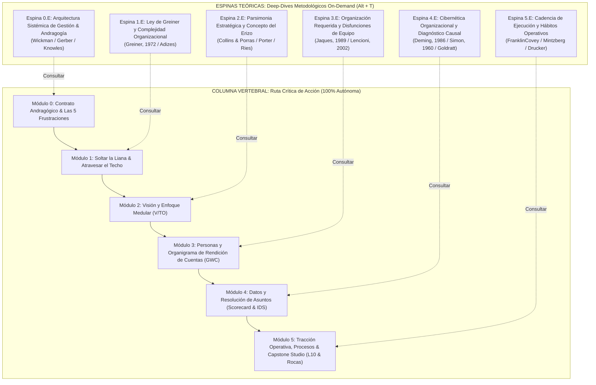
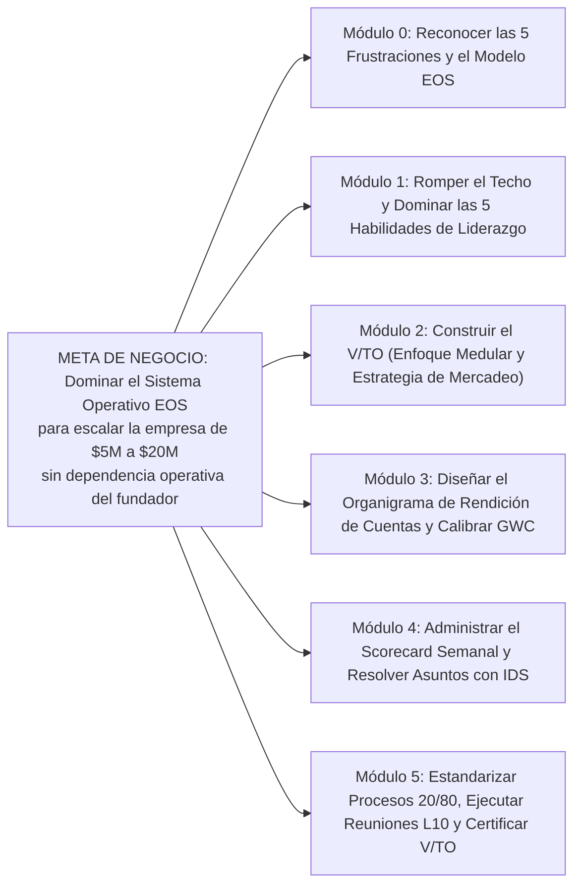

# Blueprint Instruccional: Sistema Operativo Empresarial (EOS) — Metodología Tracción
## Arquitectura Dual-Track (Spine & Fishbone) para Alta Dirección y Liderazgo

> **Materia / Tema Base:** Sistema Operativo Empresarial (EOS® - Entrepreneurial Operating System)  
> **Fuente Seminal Primaria:** Gino Wickman (2011/2018). *Tracción: Domina Tu Negocio con el Sistema Operativo Empresarial (Traction: Get a Grip on Your Business)*. BenBella Books, Inc.  
> **Público Objetivo:** Emprendedores, Fundadores/Visionarios, Directores Generales/Integradores y miembros de comités directivos de empresas medianas y en crecimiento ($2M a $50M anuales, 10 a 250 colaboradores).  
> **Formato de Salida:** Paquete SCORM 1.2 / 2004 en Single Page Application (SPA) con arquitectura de bloques Articulate Rise y Modo Dual-Track.  
> **Identidad Gráfica:** Mint Palette (#00BFA5, #0D9488, #0F172A, #F0FDFA, #EF4444, #10B981).  
> **Propósito de Negocio:** Erradicar las 5 frustraciones crónicas del negocio (falta de control, personas, falta de ganancias, estancamiento en el techo y cinismo por iniciativas fallidas) mediante la implementación pura y disciplinada de los 6 Componentes Clave de EOS.

---

## 1. Fundamentos Pedagógicos & Diagrama Dual-Track

El diseño instruccional desacopla radicalmente la ruta crítica de acción ejecutiva (Columna Vertebral / Spine) de los fundamentos teóricos, ontológicos y científicos (Espinas Teóricas / Fishbone):

### 1.1. Principios Andragógicos Innegociables
1. **Action Mapping de Kathy Moore (Anti-Information Dump):**
   - El curso NO memoriza listas ni recita definiciones de Wickman. Entrena al líder para diagnosticar disfunciones, asignar rendición de cuentas unívoca, erradicar la causa raíz de los problemas y fijar prioridades de 90 días.
   - Regla 80/20: 80% del tiempo resolviendo crisis simuladas y calibrando herramientas; 20% en píldoras Just-In-Time (JIT).
2. **Reto Invertido y Fallo Productivo (Challenge-First):**
   - Cada módulo inicia enfrentando una crisis operativa real de una empresa en expansión ("Apex Logistics Solutions"). La intuición gerencial clásica falla o genera colapso a 6 meses.
   - Tras el quiebre cognitivo, se desbloquea la fórmula pura de EOS y se aplica remediación activa.
3. **Cero Paternalismos:**
   - La retroalimentación simula consecuencias reales de negocio (pérdida de EBITDA, renuncia de talento clave, desalineación departamental, parálisis directiva) en lugar de frases complacientes.

---

## 2. Mapa de Acción (Kathy Moore Action Map)

---

## 3. Especificación Detallada Módulo por Módulo

### Módulo 0: Contrato Andragógico & Orientación al Sistema Operativo Empresarial
* **Insignia:** `Módulo 0 • Orientación Sistémica EOS`
* **Duración:** 5 minutos.
* **Lead Intro:** "Todo negocio estancado sufre una de cinco frustraciones universales. Este curso te transfiere las herramientas probadas por más de 100,000 empresas para convertir el caos operativo en tracción sistemática."
* **Las 4 Preguntas Clave de Orientación:**
  1. *¿Por qué estás aquí?* Diagnóstico de las 5 frustraciones: falta de control, problemas de personas, déficit de ganancias, choque contra el techo y cinismo por iniciativas fallidas.
  2. *¿Qué lograrás al terminar?* Compendio de las 5 competencias terminales: soltar la liana, cristalizar el V/TO, calibrar el Analizador de Personas (GWC), gobernar con el Scorecard e IDS, y fijar la cadencia de Rocas y Reunión Nivel 10.
  3. *¿Por qué reto invertido?* La intuición empresarial acumulada es exactamente lo que te trajo hasta aquí, pero es el obstáculo para el siguiente nivel. Aprenderás fallando en un entorno seguro antes de tocar la metodología.
  4. *¿Cómo funciona la dinámica Dual-Track?* La Columna Vertebral te permite certificar el curso resolviendo casos prácticos sin teoría obligatoria. Los drawers laterales (Alt + T) contienen la fundamentación académica y empírica on-demand.
* **Selector de Ruta Inicial:** Opción A (Lanzarse al Reto M1 de Apex Logistics) vs Opción B (Consultar Espina Teórica 0.E).
* **Espina Teórica 0.E:** *Arquitectura Sistémica de Gestión Emprendedora & Andragogía* (Gino Wickman, Michael Gerber y Malcolm Knowles).

---

### Módulo 1: Romper el Techo y Soltar la Liana (Onboarding Invertido)
* **Insignia:** `Módulo 1 • Diagnóstico de Complejidad & Liderazgo`
* **Duración:** 10 minutos.
* **Objetivo de Desempeño:** Diagnosticar el cuello de botella estructural en una empresa estancada y aplicar las 5 habilidades de liderazgo (Simplificar, Delegar y Elevar, Predecir, Sistematizar, Estructurar) para superar el techo de crecimiento.
* **Reto Ciego (Scenario Block):**
  * *Contexto de Crisis:* "Apex Logistics Solutions ha crecido de $2.5M a $8M en facturación y 45 empleados. Sin embargo, su fundador, Marcos Valdés, trabaja 85 horas semanales, aprueba cada compra superior a $200, atiende reclamos de clientes clave y asiste a 6 reuniones diarias. Las quejas de clientes aumentaron 34%, la rotación operativa llegó al 28% y los márgenes cayeron del 19% al 6%. Marcos convocó a su equipo para exigirles 'mayor compromiso y horas extra'."
  * *Pregunta de Diagnóstico:* "¿Cuál es la causa raíz técnica del colapso de Apex y qué decisión debe tomar Marcos de inmediato?"
  * *Opciones del Participante:*
    * **Opción A (Antipatrón 1 - Micromanagement intensivo):** Implementar un software de monitoreo de tareas por hora y centralizar la aprobación de operaciones para evitar errores del personal subalterno. $\to$ *Consecuencia simulada a 6 meses:* Marcos sufre un colapso por estrés, renuncian 2 gerentes clave y las ventas caen 22% por lentitud operativa.
    * **Opción B (Antipatrón 2 - Crecimiento forzado externo):** Contratar una agencia de marketing agresiva y contratar 10 vendedores más para duplicar la prospección y diluir los costos fijos. $\to$ *Consecuencia simulada a 6 meses:* El aumento de volumen sobrecarga una estructura operativa rota; el índice de fallas de entrega escala al 41% y clientes históricos cancelan sus contratos por incumplimiento.
    * **Opción C (Patrón de Oro EOS):** Reconocer que la empresa chocó contra el techo de complejidad; el fundador debe "soltar la liana", delegar y elevar su rol a su mejor uso, y construir un equipo de liderazgo cohesivo que comparta la responsabilidad operativa total. $\to$ *Consecuencia simulada a 6 meses:* Se distribuye la rendición de cuentas, las operaciones se estabilizan, Marcos reduce su jornada a 45 horas enfocadas en estrategia y los márgenes se recuperan al 16%.
* **Píldora Just-in-Time (Desbloqueada):**
  * *Título:* Las 5 Habilidades de Liderazgo para Romper el Techo.
  * *Reglas:*
    1. **Simplificar:** Menos es más. Procesos complejos asfixian a la organización en crecimiento.
    2. **Delegar y Elevar:** Abandonar las tareas que superaste; operar en tu mayor y mejor uso.
    3. **Predecir:** A largo plazo (escalar el árbol, visión > 90 días) y a corto plazo (resolver problemas de raíz cada semana).
    4. **Sistematizar:** Identificar y documentar la *Manera* de hacer negocios (20% de procesos medulares que dan el 80% de resultados).
    5. **Estructurar:** Diseñar la organización en base a funciones y rendición de cuentas, jamás en base a egos o personas preexistentes.
* **Espina Teórica 1.E:** *La Ley de Greiner y las Fases del Crecimiento Organizacional* (Larry E. Greiner, 1972: *Evolution and Revolution as Organizations Grow* / Ichak Adizes: *Ciclos de Vida de las Corporaciones*).

---

### Módulo 2: Visión y Enfoque Medular — El Organizador Visión/Tracción (V/TO)
* **Insignia:** `Módulo 2 • Ingeniería Estratégica V/TO`
* **Duración:** 15 minutos.
* **Objetivo de Desempeño:** Construir un Organizador Visión/Tracción (V/TO) de 2 páginas respondiendo con precisión sintáctica a las 8 preguntas maestras de EOS, eliminando planes estratégicos estériles de 50 páginas.
* **Bloque 2.1: Auditoría del Artefacto Roto:**
  * Análisis de la "Planificación Estratégica Quinquenal" de 60 páginas de Apex: misión etérea ("Ser líderes globales con excelencia humana"), 24 metas anuales dispersas y ninguna propuesta de valor diferenciada.
* **Bloque 2.2: La Fórmula Canónica del V/TO:**
  * Lado 1 (Visión): 1. Valores Medulares (3-7 reglas culturales), 2. Enfoque Medular (Propósito/Causa/Pasión + Nicho), 3. Meta a 10 Años (BHAG), 4. Estrategia de Mercadeo (Público Objetivo + 3 Cualidades Únicas + Proceso Comprobado + Garantía).
  * Lado 2 (Tracción): 5. Panorama a 3 Años, 6. Plan a 1 Año, 7. Rocas Trimestrales (3-7), 8. Lista de Asuntos.
* **Bloque 2.3: Practice Formula Builder (Ensamblador del Enfoque Medular y Estrategia de Mercadeo):**
  * Selectores interactivos en 3 fases:
    - *Bloque 1 (Propósito / Causa):* "Empoderar a empresas de manufactura para eliminar la incertidumbre en sus cadenas de suministro críticas" (Correcto) vs "Ganar mucho dinero y ser los mejores del mercado" (Antipatrón).
    - *Bloque 2 (Nicho Operativo):* "Distribución Just-In-Time para componentes industriales de alta precisión en un radio de 300 km" (Correcto) vs "Cualquier servicio logístico para cualquier tipo de cliente que pague" (Antipatrón de dispersión).
    - *Bloque 3 (Las 3 Cualidades Únicas):* "1. Visibilidad GPS en tiempo real con SLA < 15 min, 2. Custodia certificada cero mermas, 3. Facturación unificada en 24h" (Correcto) vs "1. Calidad superior, 2. Buen servicio, 3. Empleados amables" (Antipatrón de comoditización).
* **Espina Teórica 2.E:** *Parsimonia Estratégica, Concepto del Erizo y Diferenciación Radical* (Michael E. Porter, 1996: *What is Strategy?* / Jim Collins: *Good to Great* - Hedgehog Concept / Al Ries: *Focus*).

---

### Módulo 3: El Componente de las Personas — Organigrama de Rendición de Cuentas & GWC
* **Insignia:** `Módulo 3 • Calibración de Estructura y GWC`
* **Duración:** 15 minutos.
* **Objetivo de Desempeño:** Estructurar el Organigrama de Rendición de Cuentas identificando las funciones clave (Ventas/Marketing, Operaciones, Finanzas, Integrador y Visionario) y calibrar a los colaboradores con el Analizador de Personas bajo el estándar GWC (Comprenderlo, Desearlo, Capacidad).
* **Bloque 3.1: Reglas de Oro de Estructura:**
  * Cero organigramas basados en títulos o personas: primero se definen los puestos y sus 5 roles clave; luego se asignan nombres.
  * Regla de un solo responsable: Si dos personas son responsables de un área, nadie es responsable.
  * La dualidad Visionario (generador de ideas, cultura, relaciones estratégicas) vs Integrador (amarrar todo, LMA: liderar, manejar, rendir cuentas, foco operativo diario).
* **Bloque 3.2: Sorting Block (Clasificador Taxonómico del Analizador de Personas):**
  * 8 colaboradores reales de la organización a clasificar en 4 zonas operativas:
    1. **Zona 1 (Persona Correcta en Puesto Correcto):** Cumple barra de valores (+ y +/-) y tiene GWC total (Sí, Sí, Sí).
    2. **Zona 2 (Persona Correcta en Puesto Incorrecto):** Comparte valores culturales pero no comprende el rol o carece de capacidad técnica (GWC = No). *Acción EOS: Reubicar a un puesto adecuado.*
    3. **Zona 3 (Persona Incorrecta en Puesto Correcto - "El Terrorista Productivo"):** Genera grandes números técnicos pero viola los Valores Medulares (-, -). *Acción EOS: Desvincular; destruye la cultura desde adentro.*
    4. **Zona 4 (Persona Incorrecta en Puesto Incorrecto):** Falla en valores y en GWC. *Acción EOS: Despido inmediato mediante la regla de las 3 advertencias (30 días).*
* **Espina Teórica 3.E:** *Organización Requerida, Estratificación por Niveles y Disfunciones de Equipo* (Elliott Jaques, 1989: *Requisite Organization* / Patrick Lencioni, 2002: *The Five Dysfunctions of a Team*).

---

### Módulo 4: El Componente de Datos & Asuntos — Scorecard y Protocolo IDS
* **Insignia:** `Módulo 4 • Datos Predictivos & Resolución Crítica IDS`
* **Duración:** 20 minutos.
* **Objetivo de Desempeño:** Construir un Cuadro de Indicadores semanal (Scorecard) de 5 a 15 métricas predictivas (leading indicators) y desarmar síntomas superficiales en la reunión de liderazgo aplicando el protocolo IDS (Identificar causa raíz, Discutir, Solucionar).
* **Bloque 4.1: Principios del Cuadro de Indicadores:**
  * Los estados financieros son historia ("lagging indicators"); el Scorecard semanal permite ver el futuro ("leading indicators").
  * Cada número tiene una meta numérica semanal y un único responsable con nombre y apellido.
  * Cada miembro de la organización debe tener al menos un cuantificable individual (Measurable).
* **Bloque 4.2: Chat Simulator (Simulador Conversacional de Alta Tensión en Comité Directivo):**
  * *Escenario:* Reunión directiva de Apex. El Director de Operaciones (Roberto) expone un problema: "Los clientes están furiosos porque las entregas se atrasaron un 18% esta semana. Necesitamos contratar más choferes y comprar 3 camiones nuevos inmediatamente".
  * *Mecánica:* El alumno asume el rol del Integrador y debe aplicar el paso "I" de IDS (Identificar Causa Raíz) sin caer en la trampa de debatir soluciones prematuras ni culpar a terceros.
  * *Turno 1:* Roberto exige presupuesto para camiones. El alumno debe interrogar sobre el proceso de despacho, no sobre compras.
  * *Turno 2:* Roberto revela que los camiones pasan 4 horas parados esperando órdenes de carga del almacén central. El alumno sondea el procedimiento de picking y confirmación.
  * *Turno 3:* Se descubre la causa raíz: el software de almacén no sincroniza el picking hasta las 11:00 AM porque no hay un horario de corte de pedidos acordado con Ventas.
  * *Cierre:* El alumno formula la solución ejecutiva: fijar la hora de corte a las 08:00 AM y asignar la responsabilidad al Gerente de Ventas con fecha límite al viernes (To-Do asignado).
* **Espina Teórica 4.E:** *Cibernética Organizacional, Control Estadístico y Diagnóstico Causal Heurístico* (W. Edwards Deming, 1986: *Out of the Crisis* / Herbert Simon, 1960: *The New Science of Management Decision* / Eliyahu M. Goldratt: *The Goal & Theory of Constraints*).

---

### Módulo 5: Tracción Operativa, Procesos & Capstone Studio (Certificación EOS)
* **Insignia:** `Módulo 5 • Tracción & Certificación Maestra EOS`
* **Duración:** 25 minutos.
* **Objetivo de Desempeño:** Consolidar la metodología documentando los procesos medulares 20/80 ("Tu Manera"), estableciendo la cadencia de Rocas trimestrales y la agenda de 90 minutos de la Reunión Semanal Nivel 10 (L10), y completando la Ficha Maestra de Implementación EOS auditada por rúbrica binaria (100% Pass).
* **Bloque 5.1: Disciplina de Tracción:**
  * Procesos Medulares: Enfoque 20/80 (documentar el 20% que da el 80% de valor, en manuales de alto nivel de 20 páginas, y asegurar que sean Seguidos por Todos / FBA).
  * Rocas Trimestrales: Prioridades SMART de 90 días (3 a 7 para la empresa y 3 a 7 por persona).
  * Agenda de la Reunión Semanal Nivel 10 (L10 - 90 minutos exactos):
    1. Seg-Buena Noticia (5 min)
    2. Revisión del Scorecard (5 min)
    3. Revisión de Rocas (5 min)
    4. Titulares de Clientes/Empleados (5 min)
    5. Lista de Pendientes / To-Dos (5 min)
    6. IDS (60 min dedicados a resolver de raíz los 3 temas más críticos)
    7. Conclusión (5 min: acuerdos, comunicación en cascada y calificación del 1 al 10).
* **Bloque 5.2: Capstone Studio — Ficha Maestra de Implementación EOS:**
  * El participante completa la matriz integral de transformación para "Apex Logistics Solutions":
    1. *Enfoque Medular del V/TO:* Propósito/Causa + Nicho específico no comoditizado.
    2. *Organigrama de Rendición de Cuentas:* Roles y asignación GWC del Integrador y las 3 funciones básicas.
    3. *Cuadro de Indicadores Semanal (Scorecard):* 5 métricas predictivas con meta y dueño individual.
    4. *Plan de Tracción de 90 Días:* 3 Rocas SMART institucionales y agenda L10 calibrada.
* **Bloque 5.3: Rúbrica Binaria de Certificación (100% Pass):**
  * **Criterio 1 (Enfoque Medular Puro):** Define el propósito y nicho operativo sin ambigüedades genéricas ("ser los mejores", "calidad").
  * **Criterio 2 (Rendición de Cuentas Unívoca):** Asigna un solo dueño por función y evalúa GWC (Comprende, Desea, Capacidad) sin roles compartidos.
  * **Criterio 3 (Scorecard Predictivo):** Las métricas son indicadores semanales de actividad operativa (leading), prohibiendo reportes puramente contables pasados (lag).
  * **Criterio 4 (Rocas SMART de 90 Días):** Cada roca tiene resultado binario medible, fecha límite a 90 días y dueño individualizado.
* **Bloque 5.4: Motores de Exportación:**
  * Exportación en Word estructurado (.docx) y Markdown (.md).
* **Espina Teórica 5.E:** *Cadencia de Ejecución, Hábitos Organizacionales y Gobernanza de Alto Rendimiento* (FranklinCovey: *The 4 Disciplines of Execution* / Henry Mintzberg: *Structure in Fives* / Peter F. Drucker: *The Effective Executive*).

---

## 4. Matriz de Trazabilidad Seminal & Espinas Teóricas

| Módulo | Componente EOS | Autor Seminal Principal | Obra / Paper Seminal | Concepto Clave de la Espina |
|---|---|---|---|---|
| **0** | Sistema EOS | Gino Wickman & Michael Gerber | *Traction* (2011) / *The E-Myth* (1995) | Holismo Operativo y Andragogía Ejecutiva |
| **1** | Soltar la Liana | Larry E. Greiner & Ichak Adizes | *Evolution and Revolution as Organizations Grow* (HBR, 1972) | Fases de Crecimiento y Techo de Complejidad |
| **2** | Visión (V/TO) | Jim Collins, Jerry Porras & Michael Porter | *Built to Last* (1994) / *What is Strategy?* (1996) | Parsimonia Estratégica y Concepto del Erizo |
| **3** | Personas | Elliott Jaques & Patrick Lencioni | *Requisite Organization* (1989) / *The Five Dysfunctions* (2002) | Estratificación de Roles y Rendición de Cuentas |
| **4** | Datos y Asuntos | W. E. Deming, H. Simon & E. Goldratt | *Out of the Crisis* (1986) / *The Goal* (1984) | Variabilidad Estadística y Protocolo IDS de Causa Raíz |
| **5** | Tracción y Procesos | Chris McChesney, S. Covey & H. Mintzberg | *The 4 Disciplines of Execution* (2012) / *Structure in Fives* | Cadencia Semanal L10 y Hábitos de Ejecución |
